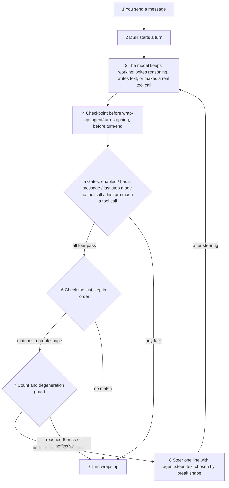

# dsh-toolcall-text-guard

> When a long task stops halfway and the turn has already ended, judge the structure of the last step at wrap-up and append one line so the same turn continues.

[English](README.en.md) · [简体中文](README.md)


A DeepSeek Harness (DSH) plugin. It hooks `agent/turn-stopping` and, before `turn/end` is written, judges from event structure whether the last step really finished. If not, it uses `agent.steer` to append one line to the same turn and lets it continue.

`turn/end completed` only means the process is still alive, not that the work is done. The interface has already stopped while the turn is written to completion as usual, and that is the most common kind of break.

## How it works



- All four gates must pass before any judgment: enabled, the turn has a message, the turn contains at least one real `tool-call`, and the last step has no `tool-call`. Exception: `reasoning-echo` is not bound by "this turn made a tool call", because a pure question-and-answer turn also writes its reasoning into the body.
- Judgment reads only the event structure of the current turn. It calls no judge model and spends no extra tokens.
- At most 6 steers per turn. Each steer records the event count at that moment. If another steer is needed but the count has not grown, it stops and writes one `give-up` line. Counts and progress are kept per "session plus turn number", so sessions do not mix.

## Judgments

Evaluated in order; the first match stops the chain:

| Group | Judgment | Steer |
| --- | --- | --- |
| Gate | `disabled` / `no-message` / `last-step-called-tool` / `no-tool-anywhere` | No |
| Empty reply | `reasoning-only`, `blank-after-tool` | Yes |
| fuhua channel delivery | `fuhua-no-report`: model name starts with `fuhua/` or `fuhua-mac/`, tools were called, but the last step has no "当前情况" or "做了哪些" section | Yes |
| Reasoning leak | `leak-unclosed`, `leak-no-body`, `leak-inner-unclosed`, `leak-residual-tag`, `leak-call-head`, `leak-has-body` | Yes for the first five, no for `leak-has-body` |
| Degenerate repeated leak | `degenerate-leak`: two or more lines start with a closing tag and body text remains after stripping the tags | Yes |
| Trailing tag stub | `leak-tail-stub`: the last sentence drags a reasoning closing tag, and after stripping it is 80 characters or less with no substantive content | Yes |
| Long text | `text-too-long`: body exceeds `maxChars` 8000 | No |
| Fragment | `tag-shape`, `tag-residual`, `json-tool-call`, `call-head`, `tag-head` | Yes |
| Exposed tags | `exposed-call-tag`: `<parameter name=…>` visible in the body, two or more `</parameter>`, two or more `</thought>` | Yes |
| Half sentence | `half-sentence`: stops at a comma, semicolon, colon, or dash, 200 characters or less | Yes |
| Plan tail | `plan-tail`, `leak-plan-tail`: the whole turn is calling tools and the last step leaves only "now / next / finally + what to do", then stops. 300 characters or less, no heading, no link, no closing question mark, no statement of completion, no waiting words | Yes |
| Reasoning echo | `reasoning-echo`: body and reasoning are almost the same passage (the shorter is at least 85% of the longer, and both are ≥200 characters) | Yes |
| Looks finished | `looks-complete` | No |

Exposed tags are the most direct signal. Normally DSH folds calls into "read file / ran command" cards, so once these tags are visible in the body, the call has degenerated into text. The check strips code blocks and inline code first, so that discussing a tag is not counted as a degenerate call.

## Quick start

```sh
# Install straight from GitHub (a CLI-managed profile such as web / main)
dsh plugin --profile <your-profile> add github:gpboyer2/dsh-toolcall-text-guard

# Local development: clone to ~/.dsh/plugins/dsh-toolcall-text-guard and install through a local link
git clone https://github.com/gpboyer2/dsh-toolcall-text-guard.git ~/.dsh/plugins/dsh-toolcall-text-guard
dsh plugin --profile <your-profile> add link:$HOME/.dsh/plugins/dsh-toolcall-text-guard

# Restart DSH
```

The `desktop` profile is owned by DeepSeek Harness.app and CLI commands against it are rejected. On the desktop build, install from the in-app Plugins page, or add the symlink to the profile's `dependencies` by hand and restart.

The bundled `cordis.patch.yml` inserts the layer into the stack automatically, so the profile patch file needs no manual edit.

Verification: after a restart, run one turn and check whether `~/.dsh/logs/toolcall-guard.log` has new lines. New lines mean it loaded.

## Core features

| Capability | Description |
| --- | --- |
| Structural judgment | Reads only the event structure of the current turn, calls no judge model, spends no extra tokens. |
| Same-turn recovery | Appends one line via `agent.steer`, starts no new turn, loses no context. |
| Text chosen by break shape | Empty reply, half sentence, tag leak, and plan tail each get their own prompt. |
| Two gates | The turn made a tool call (`reasoning-echo` excepted), and the last step made none, which avoids touching normal wrap-ups. |
| Count guard | At most 6 per turn; if the event count does not grow after a steer, it stops and writes `give-up`. |
| Per-session accounting | Counts and progress are keyed by "session plus turn number", so sessions do not mix. |
| Can be turned off | `enabled: false`, or `debug: false` to write no logs. |
| Zero dependencies | Uses only services injected by DSH and Node built-in modules. |

## Configuration

| Field | Default | Description |
| --- | --- | --- |
| `enabled` | `true` | Master switch. |
| `maxContinuations` | `6` | Maximum steers per turn. |
| `halfSentenceMax` | `200` | Length limit for the half-sentence check. |
| `fragmentMax` | `400` | Length limit for the fragment check. |
| `maxChars` | `8000` | Ordinary long text above this is left alone. |
| `debug` | `true` | Write one log line per judgment. |
| `logFile` | `~/.dsh/logs/toolcall-guard.log` | Log location. |
| `steerText*` | see `index.js` | Steer text for each break shape. |

`steerText*` means `steerText`, `steerTextBlank`, `steerTextReasoning`, `steerTextHalf`, `steerTextLeak`.

## Logs

One line per judgment, with fixed fields:

```text
<time> | turn=<turn number> | step=<step count> | why=<judgment> | recover=<true|false> | model=<model name> | used=<steers used> | text="<first 80 characters, escaped>"
```

The first 80 characters of the last step's text go into the log. Logs stay on the machine and are never uploaded. With `debug: false`, nothing is written, including `give-up` and `steer-failed`. To move the file, change `logFile`.

## Architecture

```
index.js              all plugin logic: turn-stopping listener, structural judgment, guards, steer text, logging
cordis.patch.yml      bundle patch: inserts the layer into the stack
test/                 35 tests (judgments, logs, message shapes)
```

It intervenes only at the `agent/turn-stopping` point. It reads no files, creates no sessions, and changes no turn state.

## Tests

```sh
npm test
node --test test/*.test.mjs
```

35 tests: judgment and false-positive boundaries for each break shape, the count guard and `give-up`, log fields and `debug: false`, and message shapes.

## Limits

- A real process crash cannot be recovered. When the event stream breaks mid-way and no wrap-up record is written, the plugin has no moment to intervene.
- Only known shapes are recognized. A new break shape is either missed or passed by `looks-complete`; adding one predicate fixes it.
- If the model keeps ignoring the steer, it stops. At most 6 per turn, and it also stops when the event count does not grow.
- A restart is required to take effect. The host half is an in-process module.
- It depends on the `agent/turn-stopping` seam. If upstream changes that event point, this has to follow.

## License

[MIT](LICENSE)
