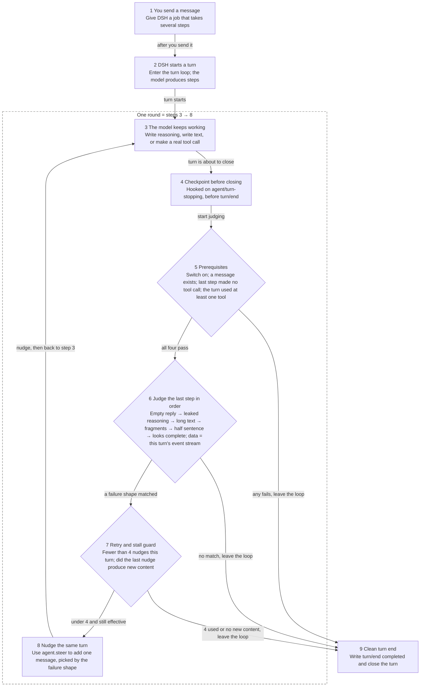

# dsh-toolcall-text-guard

中文 → [README.md](README.md)

## Is this for you?

Install it when the session event stream ends with `turn/end completed`.

- You run long jobs in DSH. The UI stops mid-work. Send one more message and it picks up again. Install it.
- `turn/end completed` at the end of the session event stream means the process is alive and the turn was closed. This plugin can fix that.
- The session event stream just cuts off, with no `turn/end completed`. The process died. Nothing here can fix it. Skip it.
- Plain Q&A turns that never called a tool. Skip it.
- It does not clash with `@deepseek-ai/dsh-text-toolcall-guard`. That one covers one shape only: a `<tool_call>` tag at the start of a line.

## Quick start

Three steps. Then restart.

```sh
# 1. Clone into ~/.dsh/plugins/dsh-toolcall-text-guard
git clone https://github.com/gpboyer2/dsh-toolcall-text-guard.git ~/.dsh/plugins/dsh-toolcall-text-guard

# 2. Add it to the desktop profile
dsh plugin --profile desktop add link:$HOME/.dsh/plugins/dsh-toolcall-text-guard

# 3. Restart DSH
```

Restart, run one turn, then check `~/.dsh/logs/toolcall-guard.log` for a new line. A new line means it loaded.

`dsh.bundle.patch` in `package.json` points at the bundled `cordis.patch.yml`. It inserts into the layer stack for you. Do not edit your profile's patch file.

## Flowchart

Nine steps, from your message to a clean turn end.



By number:

- 1 You send a message: Give DSH a job that takes several steps. Go to 2.
- 2 DSH starts a turn: Enter the turn loop, the model produces steps. Go to 3.
- 3 The model keeps working: Write reasoning, write text, or make a real tool call. Go to 4; step 8 returns here.
- 4 Checkpoint before closing: Hooked on `agent/turn-stopping`, before `turn/end`. Go to 5.
- 5 Prerequisites: All four pass → 6. Any fails → leave the loop, go to 9.
- 6 Judge the last step in order: A failure shape matched → 7. No match → leave the loop, go to 9.
- 7 Retry and stall guard: Under 4 and still effective → 8. 4 used or no new content → leave the loop, go to 9.
- 8 Nudge the same turn: Use `agent.steer` to add one message, picked by the failure shape. Back to 3.
- 9 Clean turn end: Write `turn/end completed`. Done.

## How it works

The plugin hooks `agent/turn-stopping`, before `turn/end`. Judging is structural only.

Four prerequisites. All four must pass before judging:

- Switch on.
- The turn has a message.
- At least one real `tool-call` happened in this turn.
- The last step made no `tool-call`.

Order of checks. First match wins:

- Gates: `disabled` / `no-message` / `last-step-called-tool` / `no-tool-anywhere`
- Empty reply: `reasoning-only`, `blank-after-tool`
- Leaked reasoning: `leak-unclosed`, `leak-no-body`, `leak-inner-unclosed`, `leak-residual-tag`, `leak-call-head`, `leak-has-body`
- `text-too-long`, `maxChars` 8000
- `tag-shape`, `tag-residual`, `json-tool-call`, `call-head`, `tag-head`, `half-sentence`
- `looks-complete`

`why` values:

- `disabled`, `no-message`, `last-step-called-tool`, `no-tool-anywhere`: gate failed, no nudge.
- `reasoning-only`, `blank-after-tool`: only reasoning, or nothing said after a tool result. Nudge.
- `leak-unclosed`, `leak-no-body`, `leak-inner-unclosed`: thinking tag left open, closed with no body, or a second one left open. Nudge.
- `leak-residual-tag`: only broken tags follow the closing tag, no prose at all. Nudge.
- `leak-call-head`: what follows the closing tag starts with a tool parameter tag and carries prose, e.g. `<parameter name="bash">` then a command that never finishes. Nudge.
- `leak-has-body`: a real answer follows the tag. No nudge.
- `text-too-long`: body over `maxChars` 8000. No nudge. `leak-*` ignores this limit.
- `tag-shape`: the whole message is one broken tag. Nudge.
- `tag-residual`: the whole message is nothing but tags with attributes, no prose. Nudge.
- `call-head`: the message starts with a tool parameter tag and continues with prose, e.g. `<parameter name="description" string="true">Check backend`. No normal reply ever starts that way; it is a tool call written out as text. Nudge, not capped by `fragmentMax`.
- `json-tool-call`, `tag-head`: a short JSON call fragment or a tag opening. Nudge. Both are capped by `fragmentMax` 400.
- `half-sentence`: ends on a comma, semicolon, colon, or dash. Nudge. Capped by `halfSentenceMax` 200.
- `looks-complete`: the answer reads as finished. No nudge.

Four nudges per turn at most. The plugin records the event count when it nudges. If the next judgment still wants a nudge and the count did not grow, it stops and writes a `give-up` line.

Every judgment writes one line. Synthetic example, fields masked:

```text
<time> | turn=<turn-id> | step=<step-count> | why=<verdict> | recover=<true|false> | model=<model-id> | used=<nudges-used> | text="<first 80 chars, masked>"
```

No judge model. No extra tokens.

## Other

Defaults below. Restart after any change.

| Field | Default | What it does |
| --- | --- | --- |
| `enabled` | `true` | Master switch |
| `maxContinuations` | `4` | Nudges allowed per turn |
| `halfSentenceMax` | `200` | Length cap for half-sentence checks |
| `fragmentMax` | `400` | Length cap for fragment checks |
| `maxChars` | `8000` | Long answers past this are left alone |
| `debug` | `true` | Write one log line per judgment |
| `logFile` | `~/.dsh/logs/toolcall-guard.log` | Log path |
| `steerText*` | see `index.js` | Nudge text for each failure shape |

`steerText*` covers `steerText`, `steerTextBlank`, `steerTextReasoning`, `steerTextHalf`, and `steerTextLeak`.

`debug` is `true` by default. The first 80 characters of the last step go into the log. The log stays on your machine. With `debug: false`, not one line is written, including `give-up` and `steer-failed`. Change `logFile` to move it.

Tests:

```sh
npm test
node --test test/*.test.mjs
```

14 tests.

Limits:

- A dead process is out of scope. No `turn/end` in the event stream means no hook point.
- Only shapes it knows are caught.
- If the model keeps ignoring the nudge, the plugin stops. Four nudges at most, and it stops when no new content shows up.
- Restart DSH for changes to take effect.

## License

MIT. Full text: [MIT](LICENSE).
