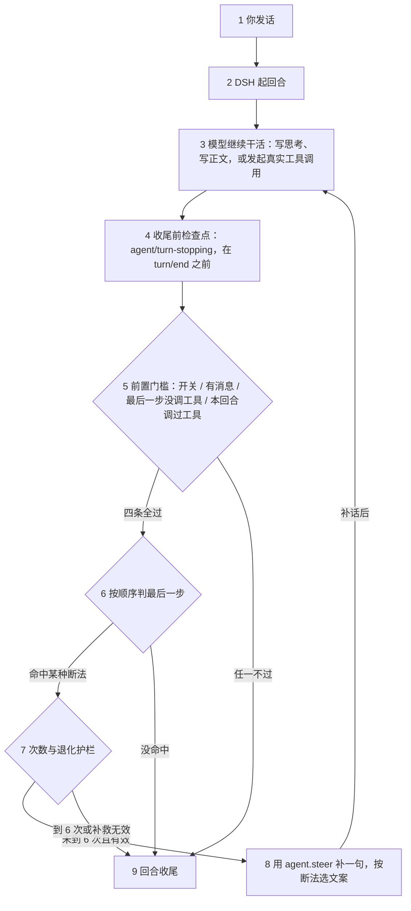

# dsh-toolcall-text-guard

> **它写下 `turn/end completed`，不代表活干完了。** —— 在收尾那一刻拦下「没说完就收工」，用一句提示把同一回合接回去。

[简体中文](README.md) · [English](README.en.md)


一个 [DeepSeek Harness](https://github.com/deepseek-ai/deepseek-harness)（DSH）插件。长任务跑到一半突然停住，界面还停在原地，回合却已经结束。插件挂在 `agent/turn-stopping`，按结构判最后一步是不是真说完了；没说完就往同一回合补一句，让它继续。

## 它解决什么问题

你派一件要分几步干完的活，它干着干着不动了，界面停住，但回合照常写下 `turn/end completed`。

- 再发一句「继续」，它又接上。装。
- 活儿没干完，这一回合却被当成「说完了」收掉了。插件在收尾那一刻拦下来，能救。
- 进程直接崩掉、事件流断在半截。没有介入时机，救不了。别装。
- 整轮没调过工具的普通问答。不用装。
- 和内置的 `@deepseek-ai/dsh-text-toolcall-guard` 不冲突：那个只管行首 `<tool_call>` 标记一种形态。

结尾有没有 `turn/end completed`，只用来分「进程还活着」和「进程崩了」，不是判定条件。界面已经停住、回合却写完了，正是最常见的那种断法。

## 工作原理



- **前置门槛**，四条全过才判定：开关打开、本回合有消息、本回合至少发生过一次真实 `tool-call`、最后一步没有 `tool-call`。例外：`reasoning-echo` 不受「本回合调过工具」这条约束，纯问答轮同样会把思考写成正文。
- **只判结构**：不调裁判模型，不花额外 token。数据就是本回合的事件流。
- **补话用 `agent.steer`**：向同一回合补一句，按断法选文案，不新起回合。
- **有护栏**：每轮最多补 6 次；补话时记下当时事件数，下次还要补、事件数却没涨，就停手并写一行 `give-up`。次数与进度按「会话 + 回合号」分开记，A 会话用掉的次数不会算到 B 头上。

## 它认得的断法

判定按顺序走，命中就停。按组看：

| 组 | 判定 | 补话? |
| --- | --- | --- |
| 门槛 | `disabled` / `no-message` / `last-step-called-tool` / `no-tool-anywhere` | 否 |
| 空回 | `reasoning-only`、`blank-after-tool` | 是 |
| 浮华通道交付物 | `fuhua-no-report`：模型名以 `fuhua/` 或 `fuhua-mac/` 开头，调过工具但末步没有「当前情况」「做了哪些」两节 | 是 |
| 思考泄漏 | `leak-unclosed`、`leak-no-body`、`leak-inner-unclosed`、`leak-residual-tag`、`leak-call-head`、`leak-has-body` | 前五个是，`leak-has-body` 否 |
| 退化重复泄漏 | `degenerate-leak`：两行以上以闭合标签起头，剥掉标签仍有正文 | 是 |
| 收尾挂标签 | `leak-tail-stub`：末句拖一个思考闭合标签，剥完不超过 80 字、无实质内容 | 是 |
| 长文 | `text-too-long`：正文超过 `maxChars` 8000 | 否 |
| 残片 | `tag-shape`、`tag-residual`、`json-tool-call`、`call-head`、`tag-head` | 是 |
| 标签裸露 | `exposed-call-tag`：正文里肉眼可见 `<parameter name=…>`、两次以上 `</parameter>`、两次以上 `</thought>` | 是 |
| 半句 | `half-sentence`：停在逗号、分号、冒号、破折号上，不超过 200 字 | 是 |
| 计划尾巴 | `plan-tail`、`leak-plan-tail`：整轮在调工具，末步只留「现在/接着/最后 + 要做的事」，说完就停。不超过 300 字、无标题、无链接、不问号收尾、不说完成、不含等待词 | 是 |
| 思考复读 | `reasoning-echo`：正文和思考几乎是同一段话（短的不低于长的 85%，且都 ≥200 字） | 是 |
| 看着说完了 | `looks-complete` | 否 |

标签裸露是最直观的一种：正常时 DSH 把调用折成「已读取文件 / 执行了命令」卡片，一旦这些标签肉眼可见地印在正文里，就说明调用退化成了文本。判定先剥掉代码块与行内代码，避免把「讨论标签」当成退化。

## 快速开始

```sh
# 1. 克隆到 ~/.dsh/plugins/dsh-toolcall-text-guard
git clone https://github.com/gpboyer2/dsh-toolcall-text-guard.git ~/.dsh/plugins/dsh-toolcall-text-guard

# 2. 注册到 profile（命令行管理的 profile，如 web / main）
dsh plugin --profile <你的profile> add link:$HOME/.dsh/plugins/dsh-toolcall-text-guard

# 3. 重启 DSH
```

> `desktop` profile 由 DeepSeek Harness.app 独占，命令行 `dsh plugin --profile desktop …` 会被拒。桌面版在应用内「插件」页安装，或手动改 profile 的 `dependencies` + 软链后重启。

包内的 `cordis.patch.yml` 会自动插入层栈，不用手改 profile 的 patch 文件。

**验证**：重启后跑一轮，看 `~/.dsh/logs/toolcall-guard.log` 有没有新增行。有新增行就是加载成功。

## 核心功能

| 能力 | 说明 |
| --- | --- |
| **结构判定** | 只看本回合事件结构，不调裁判模型，不花额外 token。 |
| **同一回合接回** | 用 `agent.steer` 补一句，不新起回合、不丢上下文。 |
| **按断法选文案** | 空回、半句、标签泄漏、计划尾巴各有各的提示。 |
| **两类门槛** | 本回合调过工具（`reasoning-echo` 例外）、末步没调工具，避免误伤正常收尾。 |
| **次数护栏** | 每轮最多 6 次；补救后事件数没涨就停手，写 `give-up`。 |
| **按会话分账** | 次数与进度按「会话 + 回合号」记，不会串会话。 |
| **可关** | `enabled: false` 或 `debug: false`，日志一行不写。 |
| **零依赖** | 只用 DSH 注入的服务与 Node 内置模块。 |

## 配置

| 字段 | 默认值 | 说明 |
| --- | --- | --- |
| `enabled` | `true` | 总开关。 |
| `maxContinuations` | `6` | 每轮最多补几次。 |
| `halfSentenceMax` | `200` | 半句判定的长度上限。 |
| `fragmentMax` | `400` | 残片判定的长度上限。 |
| `maxChars` | `8000` | 普通长文超过就不再介入。 |
| `debug` | `true` | 每判一次写一行日志。 |
| `logFile` | `~/.dsh/logs/toolcall-guard.log` | 日志位置。 |
| `steerText*` | 见 `index.js` | 各类断法的补话文案。 |

`steerText*` 指 `steerText`、`steerTextBlank`、`steerTextReasoning`、`steerTextHalf`、`steerTextLeak`。

## 日志

每判一次写一行，字段固定：

```text
<时间> | turn=<回合号> | step=<步数> | why=<判定> | recover=<true|false> | model=<模型名> | used=<已补次数> | text="<前 80 字，已占位>"
```

`debug` 默认 `true`。最后一步文本的前 80 字会进日志。日志只在本机，不上传。`debug: false` 一行都不写，含 `give-up` 和 `steer-failed`。想换位置就改 `logFile`。

## 架构

```
index.js              插件全部逻辑：turn-stopping 监听、结构判定、护栏、steer 补话、日志
cordis.patch.yml      bundle patch：插入层栈
test/                 35 条测试（判定、日志、消息形态）
```

设计约束：只在 `agent/turn-stopping` 这个点上介入；不读文件、不建会话、不改回合状态。

## 开发与测试

```sh
npm test
node --test test/*.test.mjs
```

35 条：各类断法的判定与误判边界、次数护栏与 `give-up`、日志字段与 `debug: false`、消息形态。

## 已知边界

- **进程真崩救不了**：事件流断在半截、没有写入收尾记录，插件没有介入时机。
- **只认见过的形态**：新出现的断法要么它认不出，要么被 `looks-complete` 放行；补一个判据即可。
- **模型连续不听就停手**：每轮最多 6 次，事件数没涨也停手。
- **必须重启才生效**：host 半是进程内模块。
- **依赖 `agent/turn-stopping` 接缝**：上游改这个事件点就得跟着改。

## 许可证

[MIT](LICENSE)
