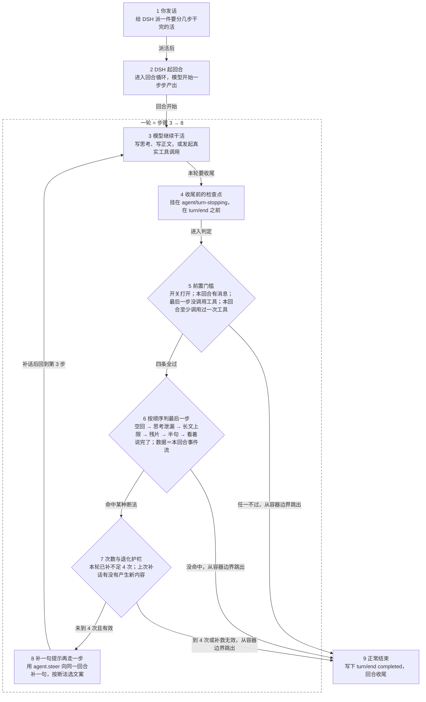

# dsh-toolcall-text-guard

English → [README.en.md](README.en.md)

## 适合你吗？

会话事件流结尾有 `turn/end completed`，就装。

- 你用 DSH 跑长任务。界面干着干着不动了。再发一句它又接上。装。
- 会话事件流结尾是 `turn/end completed`。进程活着，回合被收了尾。能救。
- 会话事件流突然截断，没有 `turn/end completed`。进程真崩。救不了。别装。
- 整轮没调过工具的普通问答，不用装。
- 和内置的 `@deepseek-ai/dsh-text-toolcall-guard` 不冲突。那个只管行首 `<tool_call>` 标记一种形态。

## 快速开始

三步装好，然后重启。

```sh
# 1. 克隆到 ~/.dsh/plugins/dsh-toolcall-text-guard
git clone https://github.com/gpboyer2/dsh-toolcall-text-guard.git ~/.dsh/plugins/dsh-toolcall-text-guard

# 2. 注册到 desktop profile
dsh plugin --profile desktop add link:$HOME/.dsh/plugins/dsh-toolcall-text-guard

# 3. 重启 DSH
```

重启后跑一轮，看 `~/.dsh/logs/toolcall-guard.log` 有没有新增行。有新增行就是加载成功。

`package.json` 的 `dsh.bundle.patch` 指向自带的 `cordis.patch.yml`，会自动插入层栈。不用手改 profile 的 patch 文件。

## 流程图

从你发话开始，到回合正常结束，一共 9 步。



按编号看：

- 1 你发话：给 DSH 派一件要分几步干完的活。去 2。
- 2 DSH 起回合：进入回合循环，模型开始一步步产出。去 3。
- 3 模型继续干活：写思考、写正文，或发起真实工具调用。去 4；第 8 步补话后回到这一步。
- 4 收尾前的检查点：挂在 `agent/turn-stopping`，在 `turn/end` 之前。去 5。
- 5 前置门槛：四条全过去 6；任一不过，从循环容器边界跳出，去 9。
- 6 按顺序判最后一步：命中某种断法去 7；没命中，从循环容器边界跳出，去 9。
- 7 次数与退化护栏：未到 4 次且有效去 8；到 4 次或补救无效，从循环容器边界跳出，去 9。
- 8 补一句提示再走一步：用 `agent.steer` 向同一回合补一句，按断法选文案。回到 3。
- 9 正常结束：写下 `turn/end completed`，回合收尾。

## 功能与原理

插件挂在 `agent/turn-stopping`，在 `turn/end` 之前动手。判定纯看结构。

前置门槛，四条全过才判定：

- 开关打开。
- 本回合有消息。
- 本回合至少发生过一次真实 `tool-call`。
- 最后一步没有 `tool-call`。

判定按顺序走，命中就停：

- 门槛：`disabled` / `no-message` / `last-step-called-tool` / `no-tool-anywhere`
- 空回：`reasoning-only`、`blank-after-tool`
- 思考泄漏：`leak-unclosed`、`leak-no-body`、`leak-inner-unclosed`、`leak-residual-tag`、`leak-call-head`、`leak-has-body`
- `text-too-long`，`maxChars` 8000
- `tag-shape`、`tag-residual`、`json-tool-call`、`call-head`、`tag-head`、`half-sentence`
- `looks-complete`

`why` 取值：

- `disabled`、`no-message`、`last-step-called-tool`、`no-tool-anywhere`：门槛没过，不补话。
- `reasoning-only`、`blank-after-tool`：只思考不落字、调完工具一个字没说。补话。
- `leak-unclosed`、`leak-no-body`、`leak-inner-unclosed`：思考标签没闭合、闭合后没正文、又开一个没闭合。补话。
- `leak-residual-tag`：标签闭合后只剩一串残标签，一个字正文都没有。补话。
- `leak-call-head`：标签闭合后跟的是一个从工具参数标签起头、还带了正文的调用，如 `<parameter name="bash">` 后接命令却没收尾。补话。
- `leak-has-body`：标签闭合后有正文。不补话。
- `text-too-long`：正文超过 `maxChars` 8000。不补话。`leak-*` 不受这个上限约束。
- `tag-shape`：整段就一个残缺标签。补话。
- `tag-residual`：整段只有带属性的残标签，没有正文。补话。
- `call-head`：整段从工具参数标签起头，标签后还带了正文，例如 `<parameter name="description" string="true">Check backend`。正常回复不会这样起头，这是把工具调用当正文写了。补话，不受 `fragmentMax` 约束。
- `json-tool-call`、`tag-head`：短文本里的 JSON 调用残片、标签开头。补话。两个都受 `fragmentMax` 400 约束。
- `half-sentence`：停在逗号、分号、冒号、破折号上。补话。受 `halfSentenceMax` 200 约束。
- `looks-complete`：看着说完了。不补话。

每轮最多补 4 次。补话时记下当时的事件数。下一次还要补话、事件数却没涨，就停手，写一行 `give-up`。

每判一次写一行日志。合成示例，字段已占位：

```text
<时间> | turn=<回合号> | step=<步数> | why=<判定> | recover=<true|false> | model=<模型名> | used=<已补次数> | text="<前 80 字，已占位>"
```

判定只看结构。不调裁判模型，不花额外 token。

## 其他

默认值如下。改完重启才生效。

| 字段 | 默认值 | 说明 |
| --- | --- | --- |
| `enabled` | `true` | 总开关 |
| `maxContinuations` | `4` | 每轮最多补几次 |
| `halfSentenceMax` | `200` | 半句判定的长度上限 |
| `fragmentMax` | `400` | 残片判定的长度上限 |
| `maxChars` | `8000` | 普通长文超过就不再介入 |
| `debug` | `true` | 每判一次写一行日志 |
| `logFile` | `~/.dsh/logs/toolcall-guard.log` | 日志位置 |
| `steerText*` | 见 `index.js` | 各类断法的补话文案 |

`steerText*` 指 `steerText`、`steerTextBlank`、`steerTextReasoning`、`steerTextHalf`、`steerTextLeak`。

`debug` 默认 `true`。最后一步文本的前 80 字会进日志。日志只在本机，不上传。`debug: false` 一行都不写，含 `give-up` 和 `steer-failed`。想换位置就改 `logFile`。

测试：

```sh
npm test
node --test test/*.test.mjs
```

14 个测试。

局限：

- 进程真崩救不了。事件流里没有 `turn/end`，插件没有介入时机。
- 只认见过的形态。
- 模型连续不听就停手。最多 4 次，没新内容也停手。
- 必须重启才生效。

## 许可证

MIT。全文见 [MIT](LICENSE)。
